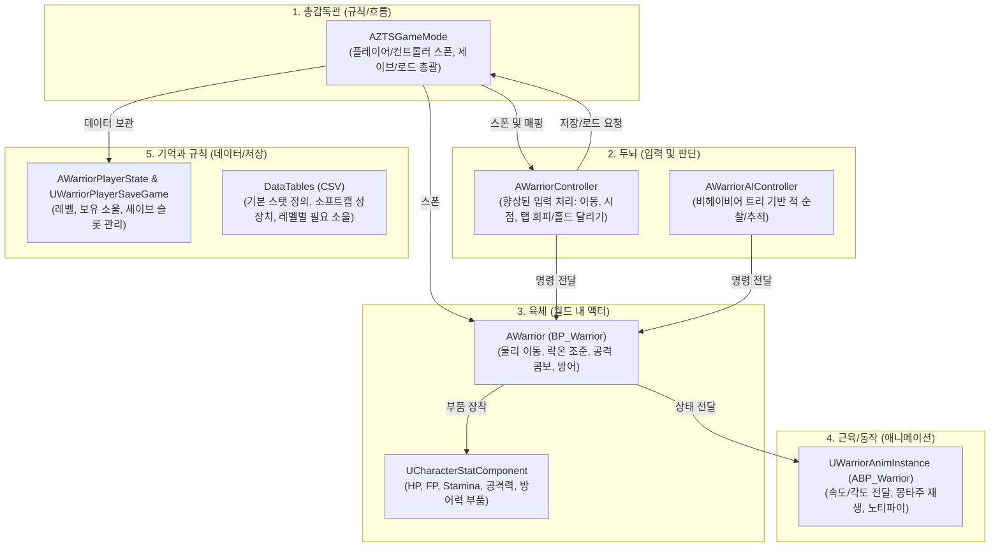

# 🎮 ZZakTungSoul (짝퉁 소울) 프로젝트 분석 및 개발 가이드북

> **작성일**: 2026-10-12  
> **프로젝트**: ZZakTungSoul (Unreal Engine 5)  
> **작성자**: Antigravity & Bae  
> **브랜치**: `Bae`

---

## 1. 프로젝트 개요 (Overview)

본 프로젝트는 **다크 소울(Dark Souls)** 및 **엘든 링(Elden Ring)**과 같은 정통 **소울라이크(Soul-like) 3인칭 액션 RPG**의 핵심 시스템을 언리얼 엔진 5의 C++과 블루프린트를 결합하여 체계적으로 구현한 프로젝트입니다.

* **엔진 버전**: Unreal Engine 5 (Enhanced Input, UMG, AIModule, StateTree 포함)
* **모듈**: `ZZakTungSoul` (Runtime)
* **핵심 타겟 메커니즘**:
  1. 탭(Tap) 회피 / 홀드(Hold) 달리기 소울라이크 입력 체계
  2. 카메라 내적(Dot Product) 기반 적 타겟팅 락온(Lock-On) 시스템
  3. 공격 콤보 애니메이션 및 노티파이(AnimNotify) 연동
  4. 플레이어/적 AI 공용 캐릭터 아키텍처
  5. 소울라이크 스탯/성장 데이터 테이블 및 세이브/로드 시스템
  6. UMG 기반 실시간 HUD (HP, FP, Stamina 게이지)

---

## 2. 전체 아키텍처 조망 (Bird's-Eye View)

언리얼 엔진의 역할 분담 원칙에 따른 전체 시스템 흐름도입니다:



---

## 3. 큰 줄기별 상세 분석 (6 Core Pillars)

### 🌿 줄기 1: 게임의 사령탑과 세이브 시스템 (GameFramework & Save)
* **주요 파일**: 
  * `Source/ZZakTungSoul/GamePlay/ZTSGameMode.h`, `.cpp`
  * `Source/ZZakTungSoul/Warrior/WarriorPlayerState.h`, `.cpp`
  * `Source/ZZakTungSoul/Data/WarriorPlayerSaveGame.h`, `.cpp`
* **역할 및 동작**:
  * `AZTSGameMode` 생성자에서 `PlayerControllerClass`, `PlayerStateClass`, `DefaultPawnClass (BP_Warrior)`를 자동 등록.
  * 슬롯(`SaveSlot`) 기반의 `SaveGame()`, `LoadGame()`, `DeleteGame()`을 제공.
  * 휘발되지 않아야 하는 영속적 데이터(플레이어 레벨, 보유 소울 등)를 `AWarriorPlayerState`와 `UWarriorPlayerSaveGame`을 통해 로컬 디스크에 직렬화 저장.

### 🌿 줄기 2: 플레이어의 손과 두뇌 (PlayerController & Enhanced Input)
* **주요 파일**: 
  * `Source/ZZakTungSoul/Warrior/WarriorController.h`, `.cpp`
  * `Content/Input/` (`IMC_Warrior`, `IA_Move`, `IA_Look`, `IA_DodgeDash`, `IA_LockOn` 등)
* **역할 및 동작**:
  * 언리얼 5 **Enhanced Input** 시스템 완벽 적용.
  * **소울라이크 시그니처 조작 (Dodge / Sprint 분기)**:
    * `ActionPressed()`에서 누른 시각(`PressStarted`)을 기록.
    * 버튼을 뗐을 때 누른 시간(`HoldTime`)이 **0.2초 미만이면 회피(`Dodge`)**, 길게 누르고 있었으면 **달리기 종료(`SprintEnd`)**로 처리.
  * 락온 상태에서 입력 축 값(X > 0 / X < 0)에 따라 타겟을 좌/우 적으로 전환하는 `ChangeLockOn()`.

### 🌿 줄기 3: 전장에 서 있는 육체 (Character & Combat)
* **주요 파일**: 
  * `Source/ZZakTungSoul/Character/CharacterBase.h`, `.cpp`
  * `Source/ZZakTungSoul/Warrior/Warrior.h`, `.cpp`
* **역할 및 동작**:
  * **수학적 락온(Lock-On) 시스템**:
    1. `OverlapMultiByChannel`로 반경 600 반경 내 타겟 탐색.
    2. 카메라 전방 벡터와 타겟 방향 벡터의 **내적(Dot Product)** 계산 (`Dot > 0.5f`, 즉 시야각 60도 이내 최적 타겟 선정).
    3. `UpdateLockOnCamera()`: 화면 좌표계 오프셋을 계산하여 카메라 Pitch/Yaw를 타겟 중심으로 보정.
    4. `UpdateLook()`: 캐릭터의 몸체 회전을 `FMath::RInterpTo`로 부드럽게 타겟 방향으로 고정.
  * **액션 및 이동 상태 머신**:
    * `EMoveState` (Idle, Walk, Run, Block, LockOn)
    * `EActionState` (None, Roll, BackStep, Attack, Hit)
    * `EOverlayState` (None, Block, OneHand, TwoHand 등 무기 파지 상태)
  * **공격 콤보**: `AttackCombo` 변수를 기반으로 연속 입력 카운트 관리.

### 🌿 줄기 4: 움직임에 생명을 주는 신경계 (Animation & Montages)
* **주요 파일**: 
  * `Source/ZZakTungSoul/Anim/WarriorAnimInstance.h`, `.cpp`
  * `Content/Blueprints/Anim/ABP_Warrior.uasset`
* **역할 및 동작**:
  * 매 프레임 `NativeUpdateAnimation()`에서 속도(`CurrentPawnSpeed`), 이동 각도(`Direction`), 상태 열거형을 갱신.
  * 락온 상태일 때는 조준점을 기준으로 스트레이프(게걸음) 이동 각도를 정밀 계산.
  * **애니메이션 노티파이(AnimNotify)** 연동:
    * `AnimNotify_ComboCheck()`: 공격 모션 중 다음 콤보 입력 여부를 판별.
    * `AnimNotify_ActionEnd()`: 공격/구르기 모션 종료 시 `EndAction()`을 호출하여 상태 초기화.

### 🌿 줄기 5: 스스로 생각하는 적 인공지능 (AI & Behavior Tree)
* **주요 파일**: 
  * `Source/ZZakTungSoul/Enemy/WarriorAIController.h`, `.cpp`
  * `Content/BehaviorTree/BT_WarriorAI.uasset`, `BB_WarriorAI.uasset`
* **역할 및 동작**:
  * `AWarrior`는 `AutoPossessAI = PlacedInWorldOrSpawned`로 설정되어 플레이어가 조종하지 않으면 자동으로 AI 컨트롤러가 장악.
  * 블랙보드 키: `Target` (감지한 플레이어), `PatrolPos` (순찰 지점).
  * 비헤이비어 트리로 적의 정찰 및 추적 로직 구동.

### 🌿 줄기 6: 상태와 스탯의 설계도 (Data & Stat Architecture)
* **주요 파일**: 
  * `Source/ZZakTungSoul/Data/StateEnum.h`
  * `Source/ZZakTungSoul/Data/StatDefine.h`
  * `Source/ZZakTungSoul/Data/StatGrowth.h`
  * `Source/ZZakTungSoul/Data/LevelRequiredSouls.h`
  * `Source/ZZakTungSoul/Character/CharacterStatComponent.h`, `.cpp`

---

## 4. 스탯 데이터 파이프라인 분석 (CSV & DataTable)

프로젝트의 `Content/Data/` 폴더에 3종의 핵심 기획 CSV 파일이 구축되어 있습니다:

| 파일명 | 역할 및 내용 | 언리얼 에셋 |
| :--- | :--- | :--- |
| `StatDefine.csv` | 주 스탯(Vigor, Strength 등) 및 파생 스탯(HP, FP, 공격력 등) 정의 | `DT_StatDefine` |
| `StatGrowth.csv` | 소프트캡(Soft Cap) 구간별 스탯 성장폭 (1~20레벨: 10, 21~40레벨: 7) | `DT_StatGrowth` |
| `LevelRequiredSouls.csv` | 레벨업에 필요한 소울량 (Lv1: 300, Lv2: 400 ... Lv10: 1200) | `DT_LevelRequiredSouls` |

### 💡 실무 개발 팁: "엑셀 사전 계산(Lookup Table)" vs "C++ 런타임 연산"
* **엑셀/CSV에 둘 것 (정적 기준표)**:
  * 레벨별 필요 소울, 1~99레벨 구간별 최종 HP/FP/Stamina 기준표 등.
  * 기획자가 엑셀 수식/함수를 활용해 밸런스를 잡고 최종 결과값을 CSV로 내보내면, C++은 `FindRow()`로 즉시 조회 가능 (코드 단순화 & 재빌드 없는 밸런스 패치).
* **C++이 계산할 것 (실시간 동적 연산)**:
  * "방어구 피해 감소율", "치명타 배율", "속성 저항력", "버프 효과" 등 실시간 전투 상황에 따라 조합되는 데미지 공식.

---

## 5. CharacterStatComponent 이슈 분석 및 개선

### 원인 분석: `CurrentHP`, `CurrentFP`는 왜 누락되어 있었을까?
* 스태미너(`CurrentStamina`)는 전투 중 순식간에 소모/회복되는 **휘발성 스탯**이라 `CharacterStatComponent`에 즉시 배치됨.
* 반면 체력/마나는 게임 저장 시 보존되어야 하는 **영속적 스탯**으로 판단되어 세이브 구조체인 `FWarriorSaveData`에 먼저 배치됨.
* 그러나 **적(Enemy) AI는 `PlayerState`를 갖지 않으므로**, 적 캐릭터의 체력을 관리하기 위해서도 `CharacterStatComponent`에 실시간 `CurrentHP`, `CurrentFP`가 반드시 필요함.

### 개선 완료 (반영 내역):
[`Source/ZZakTungSoul/Character/CharacterStatComponent.h`](file:///c:/Workspace/Unreal/ZZakTungSoul/Source/ZZakTungSoul/Character/CharacterStatComponent.h)에 다음 항목 적용 완료:
```cpp
// 능력치로부터 계산되는 최대치 (가데이터 100.f 세팅)
UPROPERTY(VisibleAnywhere, Category = "Stat")
float MaxHP = 100.f;

UPROPERTY(VisibleAnywhere, Category = "Stat")
float MaxFP = 100.f;

UPROPERTY(VisibleAnywhere, Category = "Stat")
float MaxStamina = 100.f;

// 실시간 전투 스탯 (가데이터 100.f 세팅)
UPROPERTY(VisibleAnywhere, Category = "CurrentStat")
float CurrentHP = 100.f;

UPROPERTY(VisibleAnywhere, Category = "CurrentStat")
float CurrentFP = 100.f;

UPROPERTY(VisibleAnywhere, Category = "CurrentStat")
float CurrentStamina = 100.f;
```

---

## 6. UMG HUD (체력/마나/스태미너 게이지) 제작 가이드

UI 에셋: `Content/UI/WBP_PlayerHUD.uasset`

### 계층 구조 (Hierarchy) 모범 사례
`Vertical Box`와 `Size Box`를 조합하여 개별 게이지의 두께/길이를 고정하고 일괄 정렬합니다:

```text
[Root] Canvas Panel (화면 전체 앵커)
   └─ Vertical Box (세로 정렬 상자 - 좌측 상단 앵커)
         ├─ Size Box (Width: 400, Height: 22)
         │    └─ ProgressBar_HP (Fill: Red, Is Variable: True)
         ├─ Size Box (Width: 350, Height: 18)
         │    └─ ProgressBar_FP (Fill: Blue, Is Variable: True)
         └─ Size Box (Width: 300, Height: 18)
              └─ ProgressBar_Stamina (Fill: Green, Is Variable: True)
```

### 다음 구현 단계 (Roadmap)
1. **위젯 화면 표시 (Viewport)**:
   * `AWarriorController::BeginPlay()`에서 `CreateWidget<UWBP_PlayerHUD>()` 후 `AddToViewport()`.
2. **게이지 바인딩 및 갱신**:
   * $\text{Percent} = \frac{\text{CurrentValue}}{\text{MaxValue}}$ 연산으로 각 게이지 `SetPercent()` 호출.
3. **액션 시 스태미너 소모 및 자연 회복**:
   * 구르기(`Dodge`) 시 Stamina 25 감소.
   * `Tick` 또는 타이머를 통해 비전투 시 초당 일정량 회복 로직 구현.

---

## 7. 스탯 시스템 고도화 및 HUD 연동 진행 내역 (2026-10-12 진행)

### 7-1. 모듈 의존성 설정 (`ZZakTungSoul.Build.cs`)
* C++에서 UMG 위젯(`UUserWidget`, `UProgressBar`) 및 렌더링 코어에 접근할 수 있도록 모듈 의존성 확장:
  * `PublicDependencyModuleNames`: `"UMG"` 추가 (프로젝트 전역에서 위젯 헤더 및 타입 참조 허용)
  * `PrivateDependencyModuleNames`: `"Slate"`, `"SlateCore"` 활성화 (UMG 내부 기반 레이아웃 및 렌더링 프레임워크 링크)

### 7-2. 위젯 블루프린트(`WBP_PlayerHUD`) 레이아웃 완성
* `Size Box`를 활용한 소울라이크 게이지 규격 고정 완료:
  * HP: 가로 400, 세로 22 (Red)
  * FP: 가로 350, 세로 18 (Blue)
  * Stamina: 가로 300, 세로 18 (Green)
* `Is Variable` 활성화하여 향후 C++ 및 블루프린트 바인딩 준비 완료.

### 7-3. `CharacterStatComponent.h` 인터페이스 및 이벤트 시스템 구축
* **이벤트 기반 디커플링 (Delegate)**:
  * `DECLARE_DYNAMIC_MULTICAST_DELEGATE_TwoParams(FOnStateChangedDelegate, float, CurrentValue, float, MaxValue);`
  * `OnHPChanged`, `OnFPChanged`, `OnStaminaChanged` 선언을 통해 UI와 스탯 컴포넌트 간의 결합도 최소화.
* **성능 최적화 및 안정성 (Getter)**:
  * `FORCEINLINE`과 `const`를 적용한 6종의 기본 게터 구현.
  * 0으로 나누기 방지 및 `FMath::Clamp(..., 0.f, 1.f)`를 적용한 `UFUNCTION(BlueprintPure)` 비율 게터(`GetHPRatio`, `GetFPRatio`, `GetStaminaRatio`) 구현.
* **전투 스탯 제어 인터페이스**:
  * `SetCurrentHP`, `ApplyDamage`, `SetCurrentFP`, `UseFP`, `SetCurrentStamina`, `UseStamina`, `BroadcastAllStats` 선언.
* **소울라이크 스태미너 자연 회복 파라미터**:
  * `StaminaRegenRate` (초당 30 회복, `EditAnywhere`로 에디터 튜닝 지원).
  * `StaminaRegenDelay` (소모 후 1초 지연, `EditAnywhere`로 에디터 튜닝 지원).
  * `LastStaminaUseTime` 타임스탬프 기록용 변수 및 `RegenerateStamina(float DeltaTime)` 선언.

### 7-4. 프로젝트 코드 일관성 분석 결과
* **기존 코드와 일치하는 점**:
  * 인라인 게터 스타일 (`FORCEINLINE ... const { return ...; }`) 및 대괄호 주석 컨벤션 계승.
* **개선 및 조율 포인트**:
  * 기존 프로젝트에서는 상태 머신에 `State`(`EMoveState`, `EActionState`), 능력치에는 `Stat`(`CharacterStatComponent`, `FStatDefine`)을 엄격히 구분하여 사용 중.
  * 따라서 델리게이트 이름도 `FOnStateChangedDelegate`보다 **`FOnStatChangedDelegate`**로 통일하는 것이 프로젝트 전반의 네이밍 일관성에 부합함.

---

## 8. `CharacterStatComponent.cpp` 구현 및 핵심 원리 정리 (2026-10-13 진행)

### 🤝 멘토링 및 협업 규칙 (Pair Programming Rule)
* **원칙 1**: 모든 실제 소스 코드(`.h`, `.cpp`) 타이핑 및 작성은 개발자(Bae)가 직접 수행하며, AI(Antigravity)는 원리 설명과 가이드 역할만 수행한다.
* **원칙 2**: 코드 가이드를 제공할 때는 한 번에 모든 파트를 쏟아내지 않고, **한 번에 한 파트씩만 설명**한 뒤 질의응답을 모두 마치고 다음 파트로 넘어간다.

### 8-1. `CharacterStatComponent.cpp` 구현 완료 내역
1. **초기화 및 틱 연동**:
   * `BeginPlay()`: `BroadcastAllStats()` 호출로 게임 시작 시 HUD 초기 상태 동기화.
   * `TickComponent()`: 매 프레임 `RegenerateStamina(DeltaTime)` 호출.
2. **Setter 및 델리게이트 방송 (`Broadcast`)**:
   * `SetCurrentHP`, `SetCurrentFP`, `SetCurrentStamina`: `FMath::Clamp`로 범위를 제한하고 `OnHPChanged`, `OnFPChanged`, `OnStaminaChanged` 델리게이트를 각각 `Broadcast`.
3. **전투 소모 및 피해 처리**:
   * `ApplyDamage(float InDamage)`: `0.f` 이하 데미지 무시 후 `SetCurrentHP(CurrentHP - InDamage)` 호출.
   * `UseFP(float Amount)`: 잔여 FP 확인 후 차감.
   * `UseStamina(float Amount)`: 스태미너 차감 및 `LastStaminaUseTime` 갱신.
4. **스태미너 자연 회복 (`RegenerateStamina`)**:
   * `CurrentTime - LastStaminaUseTime < StaminaRegenDelay`(1초) 동안 회복 대기 후, 초당 `StaminaRegenRate * DeltaTime`만큼 부드럽게 회복.

### 8-2. 핵심 Q&A 및 개념 노트

#### Q1. 다크 소울 스타일의 `UseStamina` 구현 방식은?
* **일반 RPG 방식**: `if (CurrentStamina < Amount) return false;` (필요량보다 적으면 아예 행동 불가)
* **심플 다크 소울 방식**: `if (CurrentStamina <= 0.f) return false;` (스태미너가 `1`이라도 남아 있으면 무조건 마지막 회피/공격 발동 후 `0`이 됨)
* **찐 다크 소울 (마이너스 스태미너/빚) 방식**:
  * 스태미너가 `5` 남았을 때 `25`짜리 액션을 쓰면 내부적으로 `-20`까지 내려가며, 다시 양수가 될 때까지 회복 시간이 더 걸리는 패널티 부여.
  * 구현 시 `SetCurrentStamina`의 하한이 `0.f`로 막혀 있으면 음수가 잘리므로, 하한을 `-50.f`로 낮추거나 `UseStamina` 내부에서 `SetCurrentStamina`를 거치지 않고 직접 `FMath::Clamp(CurrentStamina - Amount, -50.f, MaxStamina)` 처리 후 직접 1회 `Broadcast` 수행 (중복 방송 주의).

#### Q2. `if (UWorld* World = GetWorld()) { LastStaminaUseTime = World->GetTimeSeconds(); }`의 원리는?
1. **`UWorld`와 `GetWorld()`**: 액터 컴포넌트가 자신이 속한 게임 월드(세상)의 포인터를 가져옴.
2. **선언과 동시 Null 체크**: 에디터 프리뷰나 맵 전환 시 `GetWorld()`가 `nullptr`일 수 있으므로 크래시 방지를 위해 조건문 안에서 포인터 유효성을 검사함.
#### Q3. 헤더에서 왜 `#include` 대신 `class`를 붙인 전방 선언(Forward Declaration)을 쓸까?
1. **빌드(컴파일) 시간 대폭 단축**: 헤더에 불필요한 include를 줄여 다른 파일 수정 시 연쇄적으로 재컴파일되는 것을 방지함.
2. **순환 참조(Circular Include) 방지**: 두 헤더가 서로를 include하면서 발생하는 무한 루프 에러를 원천 차단함.
3. **포인터 크기(8바이트)의 특성**: 컴파일러가 클래스의 세부 멤버를 몰라도 포인터 주소 크기만 알면 되므로 헤더에서는 `class` 키워드로 존재만 귀띔하고, 실제 멤버 함수를 호출하는 `.cpp` 파일에서 진짜 `#include`를 수행함.

### 8-3. `AWarrior` 캐릭터 연동 완료 (2단계 완료)
1. **Getter 추가 (`Warrior.h`)**:
   * 외부(컨트롤러 및 UI)에서 컴포넌트에 접근할 수 있도록 `public:`에 `FORCEINLINE class UCharacterStatComponent* GetCharacterStatComponent() const` 선언.
2. **부품 인스턴스화 (`Warrior.cpp`)**:
   * `#include "Character/CharacterStatComponent.h"` 추가.
   * `AWarrior::AWarrior()` 생성자에서 `CreateDefaultSubobject<UCharacterStatComponent>(TEXT("CharacterStatComponent"))`로 부품 생성 및 장착.
3. **액션과 스태미너 연동 (`Warrior.cpp`)**:
   * `Dodge(FVector ControlDir)` 함수 시작 지점에 `if (CharacterStatComponent && !CharacterStatComponent->UseStamina(25.f)) return;` 추가.
   * 스태미너가 25 이상이면 정상 회피/백스텝 후 25 소모, 부족하면 액션 취소.
4. **빌드 검증**: Visual Studio 빌드 성공 (`Ctrl + Shift + B`).

---

## 9. C++ 기반 UMG HUD 위젯 시스템 구축 및 화면 연동 완료 (2026-10-13 진행)

### 9-1. 컨트롤러의 위젯 화면 생성 및 출력 (`AWarriorController`)
* **변수 선언 및 클래스 기본값 로드**:
  * `TSubclassOf<UUserWidget> PlayerHUDWidgetClass;`
  * `TObjectPtr<UUserWidget> PlayerHUDWidget;`
  * 생성자에서 `ConstructorHelpers::FClassFinder<UUserWidget> PlayerHUDClassRef(TEXT("/Game/UI/WBP_PlayerHUD.WBP_PlayerHUD_C"));`로 기본 클래스 자동 매핑 (언리얼 파스칼 케이스 표준 준수 및 `PlayerHUD` 접두사 일관성 유지).
* **화면 출력 (`BeginPlay`)**:
  * `CreateWidget<UUserWidget>(this, PlayerHUDWidgetClass)` 후 `AddToViewport()`로 게임 시작 즉시 화면에 렌더링.

### 9-2. 순수 C++ UI 두뇌 클래스 제작 (`UPlayerHUDWidget`)
* **경로**: `Source/ZZakTungSoul/UI/PlayerHUDWidget.h`, `.cpp`
* **아키텍처 철학 (MVC 패턴 적용)**:
  * 블루프린트는 오직 비주얼 디자인(뷰)만 담당하고, 복잡한 데이터 바인딩 및 계산 로직은 100% C++에 위임하여 블루프린트 스파게티 선을 원천 배제.
* **`meta = (BindWidget)`을 통한 1:1 자동 바인딩**:
  * `ProgressBar_HP`, `ProgressBar_FP`, `ProgressBar_Stamina`를 C++ 변수로 선언하여 `WBP_PlayerHUD`의 프로그레스 바와 컴파일 타임 1:1 자동 결합.
* **생명주기 초기화 (`NativeConstruct`)**:
  * `Super::NativeConstruct()` 호출로 엔진 기본 초기화 수행.
  * `GetOwningPlayerPawn()` ➔ `AWarrior` ➔ `GetCharacterStatComponent()` 탐색 및 안전한 널 체크.
  * `AddDynamic`으로 델리게이트 3총사 전선 연결:
    * `StatComp->OnHPChanged.AddDynamic(this, &UPlayerHUDWidget::UpdateHP);`
    * `StatComp->OnFPChanged.AddDynamic(this, &UPlayerHUDWidget::UpdateFP);`
    * `StatComp->OnStaminaChanged.AddDynamic(this, &UPlayerHUDWidget::UpdateStamina);`
  * `StatComp->BroadcastAllStats()` 호출: 게임 시작 시 현재 스탯(100/100)을 즉시 1회 방송하여 UI 초기화(0% 빈 화면 문제 해결).
* **콜백 함수 구현 (`SetPercent`)**:
  * `UpdateHP(float CurrentHP, float MaxHP)`: `FMath::Clamp(CurrentHP / MaxHP, 0.f, 1.f)` 연산 후 `ProgressBar_HP->SetPercent(Ratio)`.
  * `UpdateFP`, `UpdateStamina` 동일 구현 (`CharacterStatComponent`의 명명 규칙과 일관성 유지).

### 9-3. 위젯 블루프린트 부모 변경 (Reparent) 및 인게임 검증
* `WBP_PlayerHUD`의 부모 클래스를 `UserWidget`에서 우리가 작성한 `PlayerHUDWidget`으로 성공적으로 Reparent 완료.
* 인게임(`Alt + P`) 실행 시, 게임 시작과 동시에 HP(Red), FP(Blue), Stamina(Green) 게이지가 100%로 꽉 채워진 채 화면 좌측 상단에 정상 출력됨을 최종 검증 완료.

---

## 10. 향후 UI 고도화 로드맵 (UI Specialist Next Steps)

* **[완료] 1단계: `CharacterStatComponent` 설계 및 구현**
* **[완료] 2단계: `AWarrior` 캐릭터에 스탯 컴포넌트 부착 및 구르기 스태미너 소모 연동**
* **[완료] 3단계: `PlayerHUDWidget` C++ 클래스 제작 및 `WBP_PlayerHUD` 실시간 델리게이트 바인딩**

---

### 🎯 [진행 예정] 1. UI 코드베이스 고도화 (가독성 / 일관성 / 확장성 리팩토링)
1. **델리게이트 네이밍 일관성 완성**:
   * `FOnStateChangedDelegate` ➔ `FOnStatChangedDelegate`로 변경하여 상태 머신(`State`)과 능력치(`Stat`) 어휘 명확히 분리.
2. **UI 클래스 확장성 및 구조 정리**:
   * HUD 외에 향후 추가될 다양한 UI(스탯창, 보스 바, 알림창 등)를 체계적으로 관리할 수 있도록 컨트롤러의 UI 관리 구조 및 널 안전성 강화.
3. **주석 및 코딩 컨벤션 정돈**:
   * 파스칼 케이스, 주석 번호 체계, 카테고리 일관성 통일.

---

### 🎯 [진행 예정] 2. 소울라이크 스탯 정보창 (Status Window UI) 제작 & CSV 연동
1. **스탯창 토글 단축키 매핑**:
   * 특정 키(예: `C` 키 또는 `Tab` 키)를 눌렀을 때 스탯 정보창을 열고 닫는 토글 기능 구현.
   * 메뉴가 열렸을 때 마우스 커서 표시(`bShowMouseCursor`) 및 UI 입력 모드 전환(`SetInputModeGameAndUI`).
2. **C++ 위젯 기반 클래스 (`UStatusWindowWidget`) 제작**:
   * `Source/ZZakTungSoul/UI/StatusWindowWidget.h`, `.cpp`
3. **`Content/Data` CSV 데이터 테이블(DT)과의 동적 연동**:
   * `StatDefine.csv` (주 스탯 6종: Vigor, Attunement, Endurance, Vitality, Strength, Dexterity 및 파생 스탯 10종).
   * `StatGrowth.csv` (소프트캡 구간별 성장치) & `LevelRequiredSouls.csv` (레벨업 필요 소울).
   * 캐릭터의 현재 레벨, 보유 소울, 스탯 수치를 읽어와 텍스트 블록에 실시간 반영.
4. **위젯 블루프린트 (`WBP_StatusWindow`) 디자인**:
   * 소울라이크 특유의 중후한 메뉴 레이아웃 및 텍스트 블록 배치.


