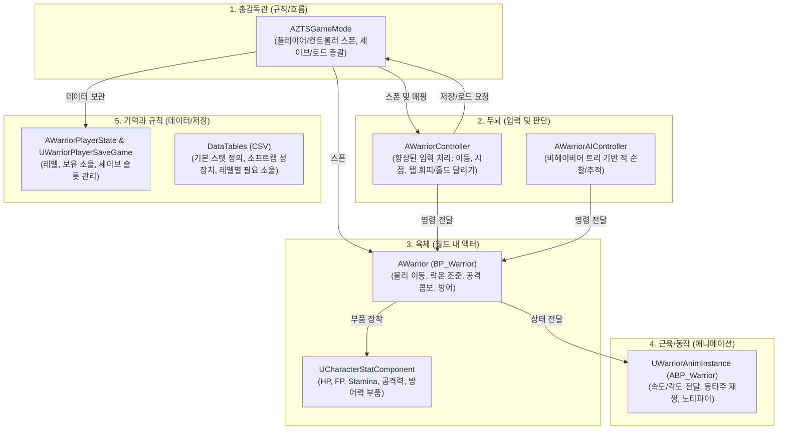

# 🎮 ZZakTungSoul (짝퉁 소울) 프로젝트 분석 및 개발 가이드북

> **작성일**: 2026-10-12  
> **프로젝트**: ZZakTungSoul (Unreal Engine 5)  
> **작성자**: Antigravity & Bae  
> **브랜치**: `Bae`

---

## 1. 프로젝트 개요 (Overview)

본 프로젝트는 **다크 소울(Dark Souls)** 및 **엘든 링(Elden Ring)**과 같은 정통 **소울라이크(Soul-like) 3인칭 액션 RPG**의 핵심 시스템을 언리얼 엔진 5의 C++과 블루프린트를 결합하여 체계적으로 구현한 프로젝트입니다.

* **엔진 버전**: Unreal Engine 5 (Enhanced Input, UMG, AIModule / StateTree 및 GameplayStateTree 플러그인은 활성화되어 있으나 AI 로직은 Behavior Tree를 전담 사용)
* **모듈**: `ZZakTungSoul` (Runtime)
* **핵심 타겟 메커니즘**:
  1. 탭(Tap) 회피 / 홀드(Hold) 달리기 소울라이크 입력 체계
  2. 카메라 내적(Dot Product) 기반 적 타겟팅 락온(Lock-On) 시스템
  3. 공격 콤보 애니메이션 및 노티파이(AnimNotify) 연동
  4. 플레이어/적 AI 공용 캐릭터 아키텍처
  5. 소울라이크 스탯/성장 데이터 테이블 및 세이브/로드 시스템
  6. UMG 기반 실시간 HUD (HP, FP, Stamina 게이지)

---

## 2. 전체 아키텍처 조망 (Bird's-Eye View)

언리얼 엔진의 역할 분담 원칙에 따른 전체 시스템 흐름도입니다:



---

## 3. 큰 줄기별 상세 분석 (6 Core Pillars)

### 🌿 줄기 1: 게임의 사령탑과 세이브 시스템 (GameFramework & Save)
* **주요 파일**: 
  * `Source/ZZakTungSoul/GamePlay/ZTSGameMode.h`, `.cpp`
  * `Source/ZZakTungSoul/Warrior/WarriorPlayerState.h`, `.cpp`
  * `Source/ZZakTungSoul/Data/WarriorPlayerSaveGame.h`, `.cpp`
* **역할 및 동작**:
  * `AZTSGameMode` 생성자에서 `PlayerControllerClass`, `PlayerStateClass`, `DefaultPawnClass (BP_Warrior)`를 자동 등록.
  * 슬롯(`SaveSlot`) 기반의 `SaveGame()`, `LoadGame()`, `DeleteGame()`을 제공.
  * 휘발되지 않아야 하는 영속적 데이터(플레이어 레벨, 보유 소울 등)를 `AWarriorPlayerState`와 `UWarriorPlayerSaveGame`을 통해 로컬 디스크에 직렬화 저장.

### 🌿 줄기 2: 플레이어의 손과 두뇌 (PlayerController & Enhanced Input)
* **주요 파일**: 
  * `Source/ZZakTungSoul/Warrior/WarriorController.h`, `.cpp`
  * `Content/Input/` (`IMC_Warrior`, `IA_Move`, `IA_Look`, `IA_DodgeDash`, `IA_LockOn` 등)
* **역할 및 동작**:
  * 언리얼 5 **Enhanced Input** 시스템 완벽 적용.
  * **소울라이크 시그니처 조작 (Dodge / Sprint 분기)**:
    * `ActionPressed()`에서 누른 시각(`PressStarted`)을 기록.
    * 버튼을 뗐을 때 누른 시간(`HoldTime`)이 **0.2초 미만이면 회피(`Dodge`)**, 길게 누르고 있었으면 **달리기 종료(`SprintEnd`)**로 처리.
  * 락온 상태에서 입력 축 값(X > 0 / X < 0)에 따라 타겟을 좌/우 적으로 전환하는 `ChangeLockOn()`.

### 🌿 줄기 3: 전장에 서 있는 육체 (Character & Combat)
* **주요 파일**: 
  * `Source/ZZakTungSoul/Character/CharacterBase.h`, `.cpp`
  * `Source/ZZakTungSoul/Warrior/Warrior.h`, `.cpp`
* **역할 및 동작**:
  * **수학적 락온(Lock-On) 시스템**:
    1. `OverlapMultiByChannel`로 반경 600 반경 내 타겟 탐색.
    2. 카메라 전방 벡터와 타겟 방향 벡터의 **내적(Dot Product)** 계산 (`Dot > 0.5f`, 즉 시야각 60도 이내 최적 타겟 선정).
    3. `UpdateLockOnCamera()`: 화면 좌표계 오프셋을 계산하여 카메라 Pitch/Yaw를 타겟 중심으로 보정.
    4. `UpdateLook()`: 캐릭터의 몸체 회전을 `FMath::RInterpTo`로 부드럽게 타겟 방향으로 고정.
  * **액션 및 이동 상태 머신**:
    * `EMoveState` (Idle, Walk, Run, Block, LockOn)
    * `EActionState` (None, Roll, BackStep, Attack, Hit)
    * `EOverlayState` (None, Block, OneHand, TwoHand 등 무기 파지 상태)
  * **공격 콤보**: `AttackCombo` 변수를 기반으로 연속 입력 카운트 관리.

### 🌿 줄기 4: 움직임에 생명을 주는 신경계 (Animation & Montages)
* **주요 파일**: 
  * `Source/ZZakTungSoul/Anim/WarriorAnimInstance.h`, `.cpp`
  * `Content/Blueprints/Anim/ABP_Warrior.uasset`
* **역할 및 동작**:
  * 매 프레임 `NativeUpdateAnimation()`에서 속도(`CurrentPawnSpeed`), 이동 각도(`Direction`), 상태 열거형을 갱신.
  * 락온 상태일 때는 조준점을 기준으로 스트레이프(게걸음) 이동 각도를 정밀 계산.
  * **애니메이션 노티파이(AnimNotify)** 연동:
    * `AnimNotify_ComboCheck()`: 공격 모션 중 다음 콤보 입력 여부를 판별.
    * `AnimNotify_ActionEnd()`: 공격/구르기 모션 종료 시 `EndAction()`을 호출하여 상태 초기화.

### 🌿 줄기 5: 스스로 생각하는 적 인공지능 (AI & Behavior Tree)
* **주요 파일**: 
  * `Source/ZZakTungSoul/Enemy/WarriorAIController.h`, `.cpp`
  * `Content/BehaviorTree/BT_WarriorAI.uasset`, `BB_WarriorAI.uasset`
* **역할 및 동작**:
  * `AWarrior`는 `AutoPossessAI = PlacedInWorldOrSpawned`로 설정되어 플레이어가 조종하지 않으면 자동으로 AI 컨트롤러가 장악.
  * 블랙보드 키: `Target` (감지한 플레이어), `PatrolPos` (순찰 지점).
  * 비헤이비어 트리로 적의 정찰 및 추적 로직 구동.

### 🌿 줄기 6: 상태와 스탯의 설계도 (Data & Stat Architecture)
* **주요 파일**: 
  * `Source/ZZakTungSoul/Data/StateEnum.h`
  * `Source/ZZakTungSoul/Data/StatDefine.h`
  * `Source/ZZakTungSoul/Data/StatGrowth.h`
  * `Source/ZZakTungSoul/Data/LevelRequiredSouls.h`
  * `Source/ZZakTungSoul/Character/CharacterStatComponent.h`, `.cpp`

---

## 4. 스탯 데이터 파이프라인 분석 (CSV & DataTable)

프로젝트의 `Content/Data/` 폴더에 3종의 핵심 기획 CSV 파일이 구축되어 있습니다:

| 파일명 | 역할 및 내용 | 언리얼 에셋 |
| :--- | :--- | :--- |
| `StatDefine.csv` | 주 스탯(Vigor, Strength 등) 및 파생 스탯(HP, FP, 공격력 등) 정의 | `DT_StatDefine` |
| `StatGrowth.csv` | 소프트캡(Soft Cap) 구간별 스탯 성장폭 (1~20레벨: 10, 21~40레벨: 7) | `DT_StatGrowth` |
| `LevelRequiredSouls.csv` | 레벨업에 필요한 소울량 (Lv1: 300, Lv2: 400 ... Lv10: 1200) | `DT_LevelRequiredSouls` |

### 💡 실무 개발 팁: "엑셀 사전 계산(Lookup Table)" vs "C++ 런타임 연산"
* **엑셀/CSV에 둘 것 (정적 기준표)**:
  * 레벨별 필요 소울, 1~99레벨 구간별 최종 HP/FP/Stamina 기준표 등.
  * 기획자가 엑셀 수식/함수를 활용해 밸런스를 잡고 최종 결과값을 CSV로 내보내면, C++은 `FindRow()`로 즉시 조회 가능 (코드 단순화 & 재빌드 없는 밸런스 패치).
* **C++이 계산할 것 (실시간 동적 연산)**:
  * "방어구 피해 감소율", "치명타 배율", "속성 저항력", "버프 효과" 등 실시간 전투 상황에 따라 조합되는 데미지 공식.

---

## 5. CharacterStatComponent 이슈 분석 및 개선

### 원인 분석: `CurrentHP`, `CurrentFP`는 왜 누락되어 있었을까?
* 스태미너(`CurrentStamina`)는 전투 중 순식간에 소모/회복되는 **휘발성 스탯**이라 `CharacterStatComponent`에 즉시 배치됨.
* 반면 체력/마나는 게임 저장 시 보존되어야 하는 **영속적 스탯**으로 판단되어 세이브 구조체인 `FWarriorSaveData`에 먼저 배치됨.
* 그러나 **적(Enemy) AI는 `PlayerState`를 갖지 않으므로**, 적 캐릭터의 체력을 관리하기 위해서도 `CharacterStatComponent`에 실시간 `CurrentHP`, `CurrentFP`가 반드시 필요함.

### 개선 완료 (반영 내역):
[`Source/ZZakTungSoul/Character/CharacterStatComponent.h`](Source/ZZakTungSoul/Character/CharacterStatComponent.h)에 다음 항목 적용 완료:
```cpp
// 능력치로부터 계산되는 최대치 (가데이터 100.f 세팅)
UPROPERTY(VisibleAnywhere, Category = "Stat")
float MaxHP = 100.f;

UPROPERTY(VisibleAnywhere, Category = "Stat")
float MaxFP = 100.f;

UPROPERTY(VisibleAnywhere, Category = "Stat")
float MaxStamina = 100.f;

// 실시간 전투 스탯 (가데이터 100.f 세팅)
UPROPERTY(VisibleAnywhere, Category = "CurrentStat")
float CurrentHP = 100.f;

UPROPERTY(VisibleAnywhere, Category = "CurrentStat")
float CurrentFP = 100.f;

UPROPERTY(VisibleAnywhere, Category = "CurrentStat")
float CurrentStamina = 100.f;
```

---

## 6. UMG HUD (체력/마나/스태미너 게이지) 제작 가이드

UI 에셋: `Content/UI/WBP_PlayerHUD.uasset`

### 계층 구조 (Hierarchy) 모범 사례
`Vertical Box`와 `Size Box`를 조합하여 개별 게이지의 두께/길이를 고정하고 일괄 정렬합니다:

```text
[Root] Canvas Panel (화면 전체 앵커)
   └─ Vertical Box (세로 정렬 상자 - 좌측 상단 앵커)
         ├─ Size Box (Width: 400, Height: 22)
         │    └─ ProgressBar_HP (Fill: Red, Is Variable: True)
         ├─ Size Box (Width: 350, Height: 18)
         │    └─ ProgressBar_FP (Fill: Blue, Is Variable: True)
         └─ Size Box (Width: 300, Height: 18)
              └─ ProgressBar_Stamina (Fill: Green, Is Variable: True)
```

### 다음 구현 단계 (Roadmap)
1. **위젯 화면 표시 (Viewport)**:
   * `AWarriorController::BeginPlay()`에서 `CreateWidget<UWBP_PlayerHUD>()` 후 `AddToViewport()`.
2. **게이지 바인딩 및 갱신**:
   * $\text{Percent} = \frac{\text{CurrentValue}}{\text{MaxValue}}$ 연산으로 각 게이지 `SetPercent()` 호출.
3. **액션 시 스태미너 소모 및 자연 회복**:
   * 구르기(`Dodge`) 시 Stamina 25 감소.
   * `Tick` 또는 타이머를 통해 비전투 시 초당 일정량 회복 로직 구현.

---

## 7. 스탯 시스템 고도화 및 HUD 연동 진행 내역 (2026-10-12 진행)

### 7-1. 모듈 의존성 설정 (`ZZakTungSoul.Build.cs`)
* C++에서 UMG 위젯(`UUserWidget`, `UProgressBar`) 및 렌더링 코어에 접근할 수 있도록 모듈 의존성 확장:
  * `PublicDependencyModuleNames`: `"UMG"` 추가 (프로젝트 전역에서 위젯 헤더 및 타입 참조 허용)
  * `PrivateDependencyModuleNames`: `"Slate"`, `"SlateCore"` 활성화 (UMG 내부 기반 레이아웃 및 렌더링 프레임워크 링크)

### 7-2. 위젯 블루프린트(`WBP_PlayerHUD`) 레이아웃 완성
* `Size Box`를 활용한 소울라이크 게이지 규격 고정 완료:
  * HP: 가로 400, 세로 22 (Red)
  * FP: 가로 350, 세로 18 (Blue)
  * Stamina: 가로 300, 세로 18 (Green)
* `Is Variable` 활성화하여 향후 C++ 및 블루프린트 바인딩 준비 완료.

### 7-3. `CharacterStatComponent.h` 인터페이스 및 이벤트 시스템 구축
* **이벤트 기반 디커플링 (Delegate)**:
  * `DECLARE_DYNAMIC_MULTICAST_DELEGATE_TwoParams(FOnStatChangedDelegate, float, CurrentValue, float, MaxValue);`
  * `OnHPChanged`, `OnFPChanged`, `OnStaminaChanged` 선언을 통해 UI와 스탯 컴포넌트 간의 결합도 최소화.
* **성능 최적화 및 안정성 (Getter)**:
  * `FORCEINLINE`과 `const`를 적용한 6종의 기본 게터 구현.
  * 0으로 나누기 방지 및 `FMath::Clamp(..., 0.f, 1.f)`를 적용한 `UFUNCTION(BlueprintPure)` 비율 게터(`GetHPRatio`, `GetFPRatio`, `GetStaminaRatio`) 구현.
* **전투 스탯 제어 인터페이스**:
  * `SetCurrentHP`, `ApplyDamage`, `SetCurrentFP`, `UseFP`, `SetCurrentStamina`, `UseStamina`, `BroadcastAllStats` 선언.
* **소울라이크 스태미너 자연 회복 파라미터**:
  * `StaminaRegenRate` (초당 30 회복, `EditAnywhere`로 에디터 튜닝 지원).
  * `StaminaRegenDelay` (소모 후 1초 지연, `EditAnywhere`로 에디터 튜닝 지원).
  * `LastStaminaUseTime` 타임스탬프 기록용 변수 및 `RegenerateStamina(float DeltaTime)` 선언.

### 7-4. 프로젝트 코드 일관성 분석 결과
* **기존 코드와 일치하는 점**:
  * 인라인 게터 스타일 (`FORCEINLINE ... const { return ...; }`) 및 대괄호 주석 컨벤션 계승.
* **개선 및 조율 포인트**:
  * 기존 프로젝트에서는 상태 머신에 `State`(`EMoveState`, `EActionState`), 능력치에는 `Stat`(`CharacterStatComponent`, `FStatDefine`)을 엄격히 구분하여 사용 중.
  * 따라서 델리게이트 이름도 `FOnStateChangedDelegate`보다 **`FOnStatChangedDelegate`**로 통일하는 것이 프로젝트 전반의 네이밍 일관성에 부합함.

---

## 8. `CharacterStatComponent.cpp` 구현 및 핵심 원리 정리 (2026-10-13 진행)

### 🤝 멘토링 및 협업 규칙 (Pair Programming & Code Review Rule)
* **원칙 1 (코드 작성 주체)**: 모든 실제 소스 코드(`.h`, `.cpp`) 타이핑 및 작성은 개발자(Bae)가 직접 수행하며, AI(Antigravity)는 아키텍처 설계와 가이드 문서(`PROJECT_GUIDE.md`) 관리만 수행한다 (소스 코드는 직접 수정하지 않음).
* **원칙 2 (독립적 코드 리뷰)**: 코드 리뷰어(Claude)는 작성된 코드와 가이드북을 교차 검증하여 `Review(Claude).md`에 개선점과 버그를 기록한다. 리뷰 문서의 체크 관리(`[x]`)는 리뷰어 전담 영역이므로 AI(Antigravity)는 리뷰 문서를 임의로 수정하거나 간섭하지 않는다.
* **원칙 3 (답변 습관 및 단계별 진행 규칙 - 필수 준수)**:
  - 질문과 진도 따라잡기를 원활히 하기 위해, 한 번에 원리와 코드를 쏟아내지 않고 **반드시 한 번에 한 단계씩만 답변하고 대기**한다.
  - **1단계 [원리 설명]**: 구현 배경과 원리만 간결하게 설명하고, 질문이 있는지 반드시 확인 후 대기.
  - **2단계 [헤더(.h) 가이드]**: 헤더 파일 코드 가이드만 제공하고, 작성 및 질문 확인 후 대기. (코드 블록의 언어 라벨로 인한 오해를 막기 위해 대상 파일 경로와 확장자 `.h`를 최상단에 명확히 표기).
  - **3단계 [소스(.cpp) 가이드]**: 소스 파일 코드 가이드만 제공하고, 작성 및 컴파일/빌드 확인 후 대기.
  - **4단계 [마무리 및 효과 정리]**: 모든 작성이 끝나면 *"이 설계를 적용하시면"* 형태로 아키텍처적 이점과 효과를 총정리하고 다음 단계 안내.

### 8-1. `CharacterStatComponent.cpp` 구현 완료 내역
1. **초기화 및 틱 연동**:
   * `BeginPlay()`: `BroadcastAllStats()` 호출로 게임 시작 시 HUD 초기 상태 동기화.
   * `TickComponent()`: 매 프레임 `RegenerateStamina(DeltaTime)` 호출.
2. **Setter 및 델리게이트 방송 (`Broadcast`)**:
   * `SetCurrentHP`, `SetCurrentFP`, `SetCurrentStamina`: `FMath::Clamp`로 범위를 제한하고 `OnHPChanged`, `OnFPChanged`, `OnStaminaChanged` 델리게이트를 각각 `Broadcast`.
3. **전투 소모 및 피해 처리**:
   * `ApplyDamage(float InDamage)`: `0.f` 이하 데미지 무시 후 `SetCurrentHP(CurrentHP - InDamage)` 호출.
   * `UseFP(float Amount)`: 잔여 FP 확인 후 차감.
   * `UseStamina(float Amount)`: 스태미너 차감 및 `LastStaminaUseTime` 갱신.
4. **스태미너 자연 회복 (`RegenerateStamina`)**:
   * `CurrentTime - LastStaminaUseTime < StaminaRegenDelay`(1초) 동안 회복 대기 후, 초당 `StaminaRegenRate * DeltaTime`만큼 부드럽게 회복.

### 8-2. 핵심 Q&A 및 개념 노트

#### Q1. 다크 소울 스타일의 `UseStamina` 구현 방식은?
* **현재 프로젝트 구현 방식 (엄격한 소모)**:
  * `if (CurrentStamina < Amount) return false;`
  * 잔여 스태미나가 요구량(25.f) 이상일 때만 액션을 허용하고 차감 (현재 Max 100 기준 4회 구르기 가능). `<` 비교로 경계값(25)에서도 정상 발동.
* **심플 다크 소울 방식 (최소 잔여량 허용)**:
  * `if (CurrentStamina <= 0.f) return false;`
  * 스태미나가 `1`이라도 남아 있으면 무조건 마지막 회피/공격 발동 후 `0`으로 소진.
* **찐 다크 소울 (마이너스 스태미나/빚) 방식**:
  * 스태미나가 `5` 남았을 때 `25`짜리 액션을 쓰면 내부적으로 `-20`까지 내려가며, 다시 양수가 될 때까지 회복 시간이 더 걸리는 패널티 부여.
  * 구현 시 `SetCurrentStamina`의 하한이 `0.f`로 막혀 있으면 음수가 잘리므로, 하한을 `-50.f`로 낮추거나 `UseStamina` 내부에서 `SetCurrentStamina`를 거치지 않고 직접 `FMath::Clamp(CurrentStamina - Amount, -50.f, MaxStamina)` 처리 후 직접 1회 `Broadcast` 수행 (중복 방송 주의).

#### Q2. `if (UWorld* World = GetWorld()) { LastStaminaUseTime = World->GetTimeSeconds(); }`의 원리는?
1. **`UWorld`와 `GetWorld()`**: 액터 컴포넌트가 자신이 속한 게임 월드(세상)의 포인터를 가져옴.
2. **선언과 동시 Null 체크**: 에디터 프리뷰나 맵 전환 시 `GetWorld()`가 `nullptr`일 수 있으므로 크래시 방지를 위해 조건문 안에서 포인터 유효성을 검사함.
#### Q3. 헤더에서 왜 `#include` 대신 `class`를 붙인 전방 선언(Forward Declaration)을 쓸까?
1. **빌드(컴파일) 시간 대폭 단축**: 헤더에 불필요한 include를 줄여 다른 파일 수정 시 연쇄적으로 재컴파일되는 것을 방지함.
2. **순환 참조(Circular Include) 방지**: 두 헤더가 서로를 include하면서 발생하는 무한 루프 에러를 원천 차단함.
3. **포인터 크기(8바이트)의 특성**: 컴파일러가 클래스의 세부 멤버를 몰라도 포인터 주소 크기만 알면 되므로 헤더에서는 `class` 키워드로 존재만 귀띔하고, 실제 멤버 함수를 호출하는 `.cpp` 파일에서 진짜 `#include`를 수행함.

### 8-3. `AWarrior` 캐릭터 연동 (초기 연동에서 인터페이스 아키텍처로 진화)
1. **Getter 및 인터페이스 확장 (`Warrior.h`)**:
   * 초기에는 구체 클래스의 `GetCharacterStatComponent()`였으나, 현재는 `ICharacterStatInterface`를 상속받아 `virtual UCharacterStatComponent* GetCharacterStatComponent() const override;`로 구현하여 UI와의 결합도를 완벽히 분리.
2. **부품 인스턴스화 (`Warrior.cpp`)**:
   * `#include "Character/CharacterStatComponent.h"` 추가.
   * `AWarrior::AWarrior()` 생성자에서 `CreateDefaultSubobject<UCharacterStatComponent>(TEXT("CharacterStatComponent"))`로 부품 생성 및 장착.
3. **액션과 스태미너 연동 (`Warrior.cpp`)**:
   * `Dodge(FVector ControlDir)` 함수 시작 지점에 `if (CharacterStatComponent && !CharacterStatComponent->UseStamina(25.f)) return;` 추가.
   * 스태미너가 25 이상이면 정상 회피/백스텝 후 25 소모, 부족하면 액션 취소.
4. **빌드 검증**: Visual Studio 빌드 성공 (`Ctrl + Shift + B`).

---

## 9. C++ 기반 UMG HUD 위젯 시스템 구축 및 화면 연동 완료 (2026-10-13 진행)

### 9-1. 컨트롤러의 위젯 화면 생성 및 출력 (`AWarriorController`)
* **변수 선언 및 클래스 기본값 로드**:
  * `TSubclassOf<UPlayerHUDWidget> PlayerHUDWidgetClass;`
  * `TObjectPtr<UPlayerHUDWidget> PlayerHUDWidget;`
  * 생성자에서 `ConstructorHelpers::FClassFinder<UPlayerHUDWidget> PlayerHUDClassRef(TEXT("/Game/UI/WBP_PlayerHUD.WBP_PlayerHUD_C"));`로 기본 클래스 자동 매핑 (`UPlayerHUDWidget` 구체 클래스 지정).
* **화면 출력 (`BeginPlay`) 및 주입 (`OnPossess`)**:
  * `BeginPlay()`에서 `CreateWidget<UPlayerHUDWidget>(this, PlayerHUDWidgetClass)` 후 `AddToViewport()`로 게임 시작 즉시 화면에 렌더링.
  * `OnPossess(APawn* InPawn)`에서 `PlayerHUDWidget->BindStatComponent(...)`로 폰 교체/부활 시 실시간 컴포넌트 주입.

### 9-2. 순수 C++ UI 두뇌 클래스 제작 (`UPlayerHUDWidget`)
* **경로**: `Source/ZZakTungSoul/UI/PlayerHUDWidget.h`, `.cpp`
* **아키텍처 철학**:
  * 블루프린트는 오직 비주얼 디자인(뷰)만 담당하고, 복잡한 데이터 바인딩 및 계산 로직은 100% C++에 위임.
* **`meta = (BindWidget)`을 통한 1:1 자동 바인딩**:
  * `ProgressBar_HP`, `ProgressBar_FP`, `ProgressBar_Stamina`를 C++ 변수로 선언하여 `WBP_PlayerHUD`의 프로그레스 바와 결합 (WBP 컴파일 시 이름 일치 필수 검증).
* **생명주기 초기화 (`NativeConstruct`) 및 안전한 주입 (`BindStatComponent`)**:
  * `NativeConstruct()`: 위젯 생성 직후 소유 폰을 탐색하여 초기 1회 바인딩 시도.
  * `BindStatComponent()`: `TWeakObjectPtr`로 댕글링 포인터를 방지하고, 기존 델리게이트 `RemoveDynamic` 후 `AddUniqueDynamic`으로 델리게이트 3총사 연결.
  * 연결 직후 Getter를 1회 호출(`UpdateProgressBar`)하여 0% 빈 화면 방지.
* **콜백 함수 구현 (`SetPercent`)**:
  * `UpdateHP(float CurrentHP, float MaxHP)`, `UpdateFP`, `UpdateStamina` 콜백에서 공통 헬퍼 `UpdateProgressBar`를 호출해 중복 코드 제거.

### 9-3. 위젯 블루프린트 부모 변경 (Reparent) 및 인게임 검증
* `WBP_PlayerHUD`의 부모 클래스를 `UserWidget`에서 우리가 작성한 `PlayerHUDWidget`으로 성공적으로 Reparent 완료.
* 인게임(`Alt + P`) 실행 시, 게임 시작과 동시에 HP(Red), FP(Blue), Stamina(Green) 게이지가 100%로 꽉 채워진 채 화면 좌측 상단에 정상 출력됨을 최종 검증 완료.

---

## 10. 향후 UI 고도화 로드맵 (UI Specialist Next Steps)

* **[완료] 1단계: `CharacterStatComponent` 설계 및 구현**
* **[완료] 2단계: `AWarrior` 캐릭터에 스탯 컴포넌트 부착 및 구르기 스태미너 소모 연동**
* **[완료] 4단계: `ICharacterStatInterface` 도입 및 주입식 HUD 바인딩 (사망/리스폰 대응 완료)**

---

### 🎯 [완료] 1. UI 코드베이스 고도화 및 안정성 강화 (Refactoring)
1. **[완료] 델리게이트 네이밍 일관성 완성**:
   * `FOnStateChangedDelegate` ➔ `FOnStatChangedDelegate`로 변경하여 상태 머신(`State`)과 능력치(`Stat`) 어휘 명확히 분리 완료.
2. **[완료] HUD 생명주기 및 안전한 바인딩 구조 개선**:
   * `ICharacterStatInterface`를 생성하여 `AWarrior`에 상속하고, 위젯의 구체 클래스 의존성을 완전 분리.
   * `AWarriorController::OnPossess`에서 빙의 시점마다 `PlayerHUDWidget->BindStatComponent(...)`로 주입 (사망/리스폰 시 Pawn 재생성 완벽 대응).
   * `PlayerHUDWidget::UpdateProgressBar` 공통 헬퍼 함수로 프로그레스 바 연산 일원화.
   * 위젯 제거 시 `NativeDestruct`에서 안전하게 델리게이트 해제.
3. **[진행 예정] 주석 및 코딩 컨벤션 정돈**:
   * 프로젝트 include 스타일 따옴표(`"..."`) 통일 및 불필요한 주석/가데이터 정리.

---

### 🎯 [진행 중] 2. 데이터 파이프라인 정립 및 스탯 정보창 (Status Window UI) 연동
1. **[완료] 기본 스탯 로딩 구현 (`CharacterStatComponent::LoadCharacterStat`)**:
   * `DT_StatDefine` 테이블에서 `HP(250)`, `FP(50)`, `Stamina(60)` 및 전투 스탯들을 `FindRow`와 람다 헬퍼로 로드 및 초기화 완료.
2. **[완료] C++ 위젯 기반 클래스 (`UStatusWindowWidget`) 제작 및 인터페이스 단일 창구 연동**:
   * `ICharacterStatInterface`를 통해 영속 세이브 데이터(`GetSaveData()`)와 실시간 전투 스탯(`GetCharacterStatComponent()`)을 단일 창구로 조회.
   * `BindWidgetOptional`을 적용하여 점진적 UI 디자인 환경 지원.
   * 람다 헬퍼를 활용한 안전한 텍스트 갱신 함수(`RefreshStatus`) 구현 완료.
3. **[완료] 스탯창 토글 단축키 매핑 및 에셋 연동 (`AWarriorController`)**:
   * 키보드 `C` 키 입력 바인딩을 통해 스탯 정보창 열기/닫기 토글 기능 구현.
   * `WarriorController` 생성자에서 `ConstructorHelpers::FClassFinder`로 `WBP_StatusWindow` 자동 매핑 완료.
   * 메뉴가 열렸을 때 마우스 커서 표시(`bShowMouseCursor = true`) 및 소울라이크 특유의 UI/게임 입력 겸용 모드(`SetInputMode(FInputModeGameAndUI())`) 전환.
   * 메뉴가 닫히면 마우스 커서 숨김 및 게임 조작 모드(`FInputModeGameOnly()`)로 복구.
4. **[완료] 위젯 블루프린트 (`WBP_StatusWindow`) 1차 제작 및 인게임 연동 검증 (2026-10-15)**:
   * `UStatusWindowWidget`을 상속받는 `WBP_StatusWindow` 생성 및 반투명 배경 레이아웃 구성.
   * `BindWidgetOptional` 기반의 `TextBlock_Level`, `TextBlock_HP` 배치 및 정상 바인딩 확인.
   * 인게임(`Alt + P`)에서 `C` 키를 눌러 스탯창 열림/닫힘 및 최신 스탯 수치 표시 최종 검증 완료.

---

## 11. 소울라이크 스탯 정보창(Status Window) 시스템 구축 및 아키텍처 (2026-10-14 진행)

### 11-1. 인터페이스 기반 단일 창구 아키텍처 (Decoupled Data Query)
* **문제의식**:
  * 스탯창 UI가 `AWarriorPlayerState`(주 스탯)와 `CharacterStatComponent`(전투 스탯)라는 서로 다른 두 구체 클래스에 각각 결합되는 것을 방지.
* **해결책**:
  * `ICharacterStatInterface`에 `virtual const FWarriorSaveData* GetSaveData() const { return nullptr; }`를 추가하여, 플레이어 캐릭터(`AWarrior`)만 이를 오버라이드.
  * UI(`UStatusWindowWidget`)는 특정 캐릭터나 PlayerState를 전혀 모른 채, 오직 `ICharacterStatInterface` 하나만 조회하여 모든 스탯을 일괄 갱신하는 **단일 창구(Single Point of Access)** 완성.

### 11-2. C++ 베이스 위젯 설계 (`UStatusWindowWidget`)
* **경로**: `Source/ZZakTungSoul/UI/StatusWindowWidget.h`, `.cpp`
* **점진적 UI 디자인 지원 (`BindWidgetOptional`)**:
  * 15개 이상의 텍스트 블록에 `BindWidgetOptional`을 적용하여, WBP 디자이너가 원하는 텍스트 블록부터 순차적으로 배치해도 컴파일 에러나 크래시가 발생하지 않음.
* **람다 헬퍼 기반 새로고침 (`RefreshStatus`)**:
  * `auto SetNumberText` 람다를 통해 유효한 텍스트 블록에만 `FText::AsNumber`로 값을 안전하게 대입.

### 11-3. 컨트롤러 토글 및 입력 모드 제어 (`AWarriorController`)
* **단축키**: `InputComponent->BindKey(EKeys::C, ...)`로 `C` 키 토글 바인딩.
* **소울라이크 실시간 메뉴 철학 반영**:
  * 메뉴가 열려도 백그라운드 월드가 멈추지 않고 실시간으로 돌아가도록 `FInputModeGameAndUI` 적용.
  * 위젯 Z-Order를 `10`으로 지정하여 기존 HUD보다 위에 떠서 화면 전체를 덮도록 구성.

---

## 12. [핵심 복습 & 아키텍처 문답집] 내가 짠 코드 완벽하게 설명하기 (2026-10-15)

> 💡 **학습 목표**: 면접이나 팀 코드 리뷰에서 *"왜 이 코드를 이렇게 설계했는가?"*라는 질문을 받았을 때, 언리얼 엔진의 원리와 객체지향 설계 근거를 바탕으로 거침없이 설명할 수 있는 핵심 문답 노트.

---

### 💬 Q1. 왜 구체 클래스 `AWarrior`를 직접 참조하지 않고 `ICharacterStatInterface`를 도입했나요?
* **핵심 답변**:
  1. **결합도 분리(Decoupling)**: 기존에는 UI(`PlayerHUDWidget`)가 `AWarrior`를 직접 `#include`하고 캐스팅(`Cast<AWarrior>`)하여 강하게 결합되어 있었습니다. 이 구조에서는 마법사 캐릭터, 보스 몬스터, NPC 등이 추가되어도 동일한 체력바 UI를 재사용할 수 없습니다.
  2. **다형성(Polymorphism)**: `ICharacterStatInterface`라는 표준 규격을 세워두고, UI는 캐릭터의 구체적인 타입을 전혀 모른 채 오직 인터페이스만 바라보도록 만들어 완벽한 모듈 독립성을 달성했습니다.
  3. **순수 가상 vs 일반 가상의 설계 차이**:
     - `GetCharacterStatComponent() = 0;`: 적이든 플레이어든 체력을 가진 모든 액터는 스탯 컴포넌트를 반드시 가져야 하므로 **순수 가상 함수**로 구현을 강제함.
     - `GetSaveData() { return nullptr; }`: 저장 데이터(레벨, 소울 등)는 오직 플레이어만 가지며 몬스터에게는 불필요하므로, 몬스터에게 강제하지 않도록 **기본값(`nullptr`)을 제공하는 일반 가상 함수**로 유연하게 설계함.

---

### 💬 Q2. 왜 `NativeConstruct`와 `AWarriorController::OnPossess`에서 HUD 바인딩을 병행하나요?
* **핵심 답변**:
  1. **초기화 순서의 불확실성 극복 (이중 안전망)**:
     - 엔진 실행 환경(PIE, 독립형 빌드, 레벨 로딩 속도)에 따라 위젯이 먼저 생성될 수도 있고, 폰 빙의가 먼저 일어날 수도 있습니다.
     - `NativeConstruct`는 위젯 생성 시 소유 폰을 찾아 즉시 바인딩을 시도하고, `OnPossess`는 컨트롤러가 폰을 빙의하는 순간마다 위젯에 컴포넌트를 주입하므로 어느 쪽이 먼저 실행되어도 초기 바인딩 누락이 발생하지 않습니다.
  2. **사망 및 리스폰(Pawn 재생성) 시 댕글링 방지와 UI 미갱신 해결**:
     - 위젯의 `NativeConstruct`는 게임 시작 시 위젯이 생성될 때 단 1번만 실행됩니다.
     - 소울라이크 게임에서 플레이어가 사망하여 액터가 파괴되고 새 캐릭터로 부활했을 때, 1회성 `NativeConstruct`만 사용하면 UI는 이미 소멸된 옛날 캐릭터의 컴포넌트 델리게이트에 머물게 되어 **체력바가 더 이상 갱신되지 않는 먹통 현상**이 발생합니다.
     - 언리얼 엔진에서 컨트롤러가 새로운 캐릭터 육체를 장악할 때마다 무조건 호출되는 공식 생명주기 함수인 `OnPossess(APawn* InPawn)`에서 `PlayerHUDWidget->BindStatComponent(...)`를 재호출함으로써 부활 시마다 최신 캐릭터로 즉시 교체 연결됩니다.
  3. **`BindStatComponent` 내부의 3중 방어 기제**:
     - `RemoveDynamic`: 혹시 남아있는 이전 캐릭터의 전선을 깔끔하게 끊어 유령 브로드캐스트 수신 차단.
     - `AddUniqueDynamic`: 중복 바인딩으로 인해 콜백 함수가 한 번에 여러 번 불리는 현상 차단.
     - `TWeakObjectPtr`: 캐릭터 소멸 시 일반 Raw 포인터의 허위 주소(Dangling) 참조 위험을 원천 차단하고 안전하게 유효성(`IsValid()`) 감지.

---

### 💬 Q3. 델리게이트를 연결하자마자 왜 컴포넌트의 Getter를 1회 직접 호출하나요?
* **핵심 답변**:
  1. **델리게이트의 성격**: 델리게이트(이벤트)는 "체력이 깎였다!", "스태미나를 썼다!"처럼 **상태가 '변화하는 순간'에만 울리는 벨**입니다.
  2. **최초 연결 시점의 맹점**: UI가 처음 켜졌거나 새 캐릭터에 연결된 순간에는 아무런 피해도 입지 않은 평화로운 상태(변화 없음)이므로, 델리게이트 방송이 전혀 오지 않아 체력바가 **0%인 빈 깡통 상태**로 남게 됩니다.
  3. **해결 (스냅샷 즉시 읽기)**: 따라서 전선을 꽂자마자(바인딩 직후), Getter(`GetCurrentHP()`, `GetMaxHP()`)로 **현재 상태의 스냅샷을 1회 즉시 읽어서 게이지를 꽉 채워주고(Initial Refresh)**, 그 이후부터 실시간 변화를 델리게이트로 수신하도록 설계했습니다.
  4. **보완 안전망 (`BroadcastAllStats`)**: 컴포넌트의 `BeginPlay`에서도 `BroadcastAllStats()`를 호출해 두는데, 이는 위젯 바인딩이 폰의 `BeginPlay`보다 늦게 일어나는 예외적 상황에서도 `LoadCharacterStat`으로 읽어온 250/50/60 수치가 HUD에 최종 반영되도록 돕는 상호 보완 안전망 역할을 합니다.

---

### 💬 Q4. 스탯 데이터 로딩에서 왜 `GetAllRows` 대신 `FindRow`와 정적 키를 썼나요?
* **핵심 답변**:
  1. **`GetAllRows`의 한계**: `GetAllRows`는 테이블의 행들을 순서 없는 TArray로 긁어오므로 "어느 행이 HP인지, FP인지" 행 이름(Key)을 직접 핀포인트로 특정할 수 없어 순회 비용이 들고 기획 변경에 취약합니다.
  2. **`FindRow`의 핀포인트 조회**: CSV의 고유 행 이름(Key: `"HP"`, `"FP"`)을 인덱스로 넘겨 $O(1)$에 준하는 해시 조회를 수행하므로 코드가 간결하고 빠릅니다.
  3. **정적 키(`inline static const FName`)의 역할**: `TEXT("HP")` 같은 문자열 리터럴을 함수마다 직접 하드코딩하면 휴먼 에러(철자 오타)가 발생하기 쉬우므로, `HpKey`, `FpKey` 등의 static 상수로 묶어 코드 작성 시 심볼 오타를 방지했습니다. *(주의: FName 키가 실제 CSV 에셋의 행 이름과 일치하는지는 컴파일 타임이 아닌 런타임 검사 영역이므로, `FindRow` 반환 포인터에 대한 Nullptr 검사와 방어 로그가 필수적입니다)*

---

### 💬 Q5. 스탯창(`StatusWindowWidget`)은 왜 `BindWidgetOptional`과 인터페이스 단일 창구를 썼나요?
* **핵심 답변**:
  1. **`BindWidgetOptional` (점진적 UI 디자인 환경 지원)**:
     - `BindWidget`을 쓰면 C++에 선언된 20여 개의 텍스트 블록이 WBP 에셋에 단 하나라도 누락되었을 때 WBP 컴파일 에러가 발생하여 에셋 저장이 차단됩니다.
     - `BindWidgetOptional`을 통해 WBP 디자이너가 원하는 항목(예: HP, 레벨)부터 하나씩 배치하며 점진적으로 UI를 완성할 수 있게 배려했습니다.
     - 런타임 Null 포인터 접근을 방지하기 위해 `auto SetNumberText`와 같은 람다 헬퍼를 도입하여 위젯이 바인딩된 경우에만 안전하게 텍스트를 대입합니다.
  2. **인터페이스 단일 창구 (Single Point of Query)**:
     - `ICharacterStatInterface`가 컴포넌트(`GetCharacterStatComponent`)뿐만 아니라 세이브 데이터(`GetSaveData`)까지 한곳에서 제공하므로, 위젯은 `PlayerState` 구체 클래스를 몰라도 인터페이스 하나만으로 영속 스탯과 전투 스탯을 일괄 조회(`RefreshStatus`)할 수 있습니다.
  3. **인게임 연동 검증 완료 (2026-10-15)**: `WBP_StatusWindow`를 생성하여 `AWarriorController`에 연결하고, 인게임(`Alt + P`)에서 `C` 키를 눌러 전체 화면 반투명 스탯창이 정상적으로 열리고 닫히며 레벨/HP 데이터가 출력됨을 최종 검증 완료함.

---

### 💬 Q6. 소울라이크 특유의 스태미나 자연 회복 지연은 어떻게 구현했나요?
* **핵심 답변**:
  1. **타임스탬프(`GetTimeSeconds`) 방식**:
     - 구르기나 공격으로 스태미나를 소모하는 순간, `GetWorld()->GetTimeSeconds()`로 마지막 소모 시각(`LastStaminaUseTime`)을 찍어둡니다.
  2. **지연 시간 검사 (`StaminaRegenDelay`)**:
     - `TickComponent`에서 매 프레임 `RegenerateStamina(DeltaTime)`를 호출하여, `CurrentTime - LastStaminaUseTime < 1.0f` 동안은 회복을 일시 중단(숨고르기 딜레이)합니다.
  3. **프레임 독립적 회복 (`DeltaTime`)**:
     - 지연 시간이 지나면 `StaminaRegenRate * DeltaTime` (초당 30)만큼 매 프레임 부드럽게 누적 회복하며, 최대치(`MaxStamina`) 도달 시 `Clamp` 처리합니다.

---

### 💬 Q7. 언리얼 엔진의 스폰/빙의 라이프사이클 순서와 HUD 바인딩 타이밍은?
* **핵심 답변**:
  * **전형적인 엔진 스폰 및 초기화 순서**:
    1. `AZTSGameMode::PostLogin` (또는 게임 시작)
    2. `AWarriorController::BeginPlay()`: HUD 위젯 생성(`CreateWidget`) 및 뷰포트 등록(`AddToViewport`).
    3. `AWarriorController::OnPossess(APawn* InPawn)`: 컨트롤러가 월드의 폰을 장악.
    4. `AWarrior::BeginPlay()`: 폰 본체의 초기화.
    5. `UCharacterStatComponent::BeginPlay()`: 폰의 부품인 컴포넌트 초기화 (`LoadCharacterStat` 및 `BroadcastAllStats`).
  * **설계 시사점**:
    - 위젯 생성 시점에는 아직 폰 빙의가 일어나지 않았거나 컴포넌트가 로드되지 않았을 수 있습니다.
    - 따라서 `PlayerHUDWidget::NativeConstruct` 한곳에만 바인딩을 맡기면 안 되며, `OnPossess` 시점에 `BindStatComponent`로 확실하게 컴포넌트를 주입해 주는 구조가 필수적입니다.

---

### 💬 Q8. 왜 일반 C++ 델리게이트가 아닌 'Dynamic Multicast Delegate'를 사용했나요?
* **핵심 답변**:
  1. **언리얼 리플렉션 및 UFUNCTION 지원**:
     - `DECLARE_DYNAMIC_MULTICAST_DELEGATE`는 엔진의 UObject 리플렉션 시스템과 연동되므로, 바인딩 대상 함수가 반드시 `UFUNCTION()`이어야 합니다. 이를 통해 런타임에 안전하게 함수 포인터를 찾고 실행합니다.
  2. **중복 방지 (`AddUniqueDynamic`) 및 안전한 해제 (`RemoveDynamic`)**:
     - 일반 멀티캐스트는 중복 바인딩 검사가 까다롭지만, Dynamic 델리게이트는 `AddUniqueDynamic`을 제공하여 실수로 동일 함수가 2번 연결되는 사고를 원천 방지합니다.
  3. **블루프린트 확장성**:
     - `BlueprintAssignable` 지정자를 통해 C++뿐만 아니라 블루프린트 에디터의 이벤트 그래프에서도 드래그 앤 드롭으로 이벤트를 수신할 수 있어 기획/아트 팀과의 협업에 매우 유리합니다.

---

### 💬 Q9. `UINTERFACE`의 U/I 클래스 쌍 구조와 `Cast<ICharacterStatInterface>`의 원리는?
* **핵심 답변**:
  1. **U/I 클래스 쌍의 분리 이유**:
     - 언리얼 엔진은 C++의 다중 가상 상속을 허용하지 않으므로, UObject 시스템 메타데이터를 위한 `UCharacterStatInterface (UInterface)`와 실제 C++ 순수 가상 함수를 정의하는 `ICharacterStatInterface`의 쌍으로 선언됩니다.
  2. **`Cast<IInterface>`의 작동 및 Null 안전성**:
     - 언리얼의 `Cast<ICharacterStatInterface>(Pawn)`는 런타임 타입 정보(RTTI/UClass)를 검사하여, 해당 폰이 인터페이스를 상속받았는지 확인합니다. 상속받지 않은 액터라면 예외 없이 즉시 `nullptr`를 안전하게 반환합니다.
  3. **C++ 전용 vs 블루프린트 구현 차이**:
     - 순수 C++ 인터페이스는 가상 함수(`virtual ... = 0`)로 깔끔하게 작성 가능하지만, 블루프린트에서도 인터페이스를 구현하게 하려면 `UFUNCTION(BlueprintNativeEvent)`으로 선언하고 C++에서는 `_Implementation` 접미사 함수를 구현해야 합니다.

---

### 💬 Q10. `BindWidget` vs `BindWidgetOptional`의 설계적 차이는?
* **핵심 답변**:
  | 구분 | `meta = (BindWidget)` | `meta = (BindWidgetOptional)` |
  | :--- | :--- | :--- |
  | **컴파일 검증** | WBP 컴파일/저장 시 위젯 이름이 없으면 **컴파일 에러 발생** | 위젯이 없어도 에러 없이 **정상 컴파일 및 저장 허용** |
  | **런타임 포인터** | 정상 컴파일된 에셋이라면 런타임에 100% 유효 포인터 보장 | WBP에 배치되지 않았으면 런타임에 **`nullptr`** 상태 |
  | **프로젝트 적용처** | `ProgressBar_HP/FP/Stamina` (필수 전투 HUD) | `StatusWindowWidget`의 20여 개 텍스트 블록 (점진적 디자인) |
  | **C++ 방어 코드** | 널 체크가 필수는 아니나 안전을 위해 권장 | **널 체크 절대 필수** (람다 헬퍼 `if (Widget) Widget->SetText(...)` 필수) |

---

### 💬 Q11. 언리얼 스마트 포인터 3총사 (`TObjectPtr`, `TWeakObjectPtr`, Raw Pointer)의 용도와 차이는?
* **핵심 답변**:
  1. **`TObjectPtr<T>` (강한 참조 / 소유)**:
     - 언리얼 5에서 기본 권장되는 UObject 포인터로, `UPROPERTY()`와 함께 사용되어 엔진의 가비지 컬렉터(GC)에게 "이 객체는 내가 쓰고 있으니 메모리에서 지우지 마라"고 알립니다.
     - 적용처: 컨트롤러가 소유하는 위젯 인스턴스 (`PlayerHUDWidget`, `StatusWindowWidget`).
  2. **`TWeakObjectPtr<T>` (약한 참조 / 비소유 관찰자)**:
     - 객체의 수명(GC)에 일절 관여하지 않으면서, 대상 객체가 다른 곳에서 파괴(`DestroyActor`)되었을 때 이를 스스로 감지하여 포인터를 자동으로 `nullptr`처럼 무효화(`IsValid() == false`)합니다.
     - 적용처: `PlayerHUDWidget`이 바라보는 `CurrentStatComponent`. (캐릭터가 죽어서 컴포넌트가 파괴되었을 때 댕글링 포인터 크래시 방지).
  3. **Raw Pointer (`T*`)의 위험성**:
     - GC가 메모리를 해제해도 주소값을 그대로 쥐고 있어(Dangling Pointer), 잘못 접근하면 프로그램이 즉시 강제 종료됩니다. 액터/컴포넌트의 장기 보관용으로는 절대 지양해야 합니다.

---

### 💬 Q12. `CreateDefaultSubobject`와 `FClassFinder`는 왜 '생성자'에서만 써야 할까요?
* **핵심 답변**:
  1. **CDO(Class Default Object) 구축 타이밍**:
     - 언리얼 엔진은 엔진 초기화 시점에 클래스마다 하나의 원형 붕어빵인 CDO를 메모리에 굽습니다.
     - `CreateDefaultSubobject`는 액터의 기본 컴포넌트 계층 구조를 CDO에 영구 각인시키는 함수이므로 오직 C++ 생성자에서만 동작합니다. (런타임에 부품을 붙일 때는 `NewObject<T>()` + `RegisterComponent()` 사용).
  2. **`FClassFinder`와 `_C` 접미사**:
     - 생성자 헬퍼(`ConstructorHelpers::FClassFinder`) 역시 CDO 생성 시점에 에셋을 정적으로 참조하기 위한 도구입니다.
     - 위젯 블루프린트(`WBP`)나 액터 블루프린트(`BP`)는 에셋 자체를 가리키는 것이 아니라 엔진이 생성한 UClass 바이트코드를 읽어야 하므로, 경로 끝에 반드시 `_C` (UBlueprintGeneratedClass) 접미사를 붙여야 합니다.

---

### 💬 Q13. 영속 데이터(PlayerState/SaveGame)와 휘발 데이터(Component)는 왜 분리해야 할까요?
* **핵심 답변**:
  1. **소울라이크의 '죽음과 부활' 사이클**:
     - 플레이어가 죽으면 월드에 서 있던 `AWarrior` 육체와 그 부품인 `CharacterStatComponent`는 완전히 소멸(Destroy)되고 가비지 컬렉션됩니다.
     - 하지만 플레이어의 레벨, 보유 소울, 강화 수치, 인벤토리는 부활 후에도 그대로 보존되어야 합니다.
  2. **책임과 수명의 분리**:
     - **`AWarriorPlayerState` & `UWarriorPlayerSaveGame`**: 폰이 파괴되거나 레벨이 바뀌어도 게임 세션 동안 살아남아 디스크에 저장/로드되는 **영속 데이터(Persistent Data)** 담당.
     - **`CharacterStatComponent`**: 현재 프레임의 전투 상황(실시간 HP 깎임, 스태미나 소모/회복)을 연산하고 화면에 뿌려주는 **휘발성 전투 엔진(Volatile Engine)** 담당.
     - 부활 시 `PlayerState`의 영속 데이터를 읽어와 새로 스폰된 폰의 `CharacterStatComponent`를 초기화(`UpdateCharacterStat`)하는 명확한 파이프라인이 성립됩니다.

---

### 💬 Q14. 언리얼 입력 모드 3종 비교표 (`GameOnly`, `UIOnly`, `GameAndUI`)
* **핵심 답변**:
  | 입력 모드 | 게임 월드 입력 (이동/시점) | UI 위젯 입력 (클릭/포커스) | 마우스 커서 표시 | 적용 사례 |
  | :--- | :---: | :---: | :---: | :--- |
  | **`FInputModeGameOnly`** | **활성 (100%)** | 비활성 | 숨김 (`bShowMouseCursor = false`) | 일반 필드 탐험, 실시간 전투 조작 |
  | **`FInputModeUIOnly`** | 완전 차단 | **활성 (100%)** | 표시 (`bShowMouseCursor = true`) | 메인 타이틀 메뉴, 팝업 확인창 (게임 정지) |
  | **`FInputModeGameAndUI`** | **활성 (배경 동작)** | **활성 (우선권)** | **표시 (`bShowMouseCursor = true`)** | **소울라이크 실시간 스탯창/인벤토리 창** |

> 💡 **소울라이크 철학**: 다크 소울이나 엘든 링은 인벤토리나 스탯창을 열어도 게임이 일시정지되지 않고 뒤에서 몬스터가 다가옵니다. 따라서 `FInputModeGameAndUI`를 적용하여 마우스로 UI를 누르면서도 WASD로 도망칠 수 있는 긴장감을 유지하도록 구현했습니다.

---

### 💬 Q15. UMG 디자이너 실무 테크닉 (Canvas Panel, Is Variable, 일괄 여백)
* **핵심 답변**:
  1. **`Canvas Panel`의 본질 (투명 도화지와 절대 좌표)**:
     - 3D 게임 월드 렌더링 화면 자체가 아니라, 모니터 화면 위에 덧씌워지는 "투명한 2D 유리 셀로판지"입니다.
     - 자식 위젯을 원하는 화면 좌표(X, Y)에 자유롭게 얹고 앵커(Anchor)를 지정할 수 있는 유일한 자유 배치 패널입니다.
  2. **`Is Variable`의 켜짐과 꺼짐 (정적 라벨 vs 동적 변수)**:
     - `Is Variable`을 체크 해제하면 C++이나 블루프린트 그래프에 변수로 등록되지 않는 **순수 정적 라벨(Static Text)**이 되어 에디터에 적어둔 글자("Level", "HP" 등)가 고정 출력되며 메모리와 바인딩 비용이 절약됩니다.
     - 실시간 수치를 갱신해야 하는 위젯(예: `TextBlock_Level`, `TextBlock_HP`)만 `Is Variable`을 켜고 C++ 변수명과 1:1로 일치시킵니다.
  3. **`Wrap With...`와 일괄 Padding 팁**:
     - 여러 텍스트를 한 줄이나 한 열로 묶을 때는 다중 선택 후 우클릭 ➔ `Wrap With... (Vertical Box/Horizontal Box)`를 사용해 한 덩어리로 묶으면 이동과 정렬이 매우 쉬워집니다.
     - 자식들을 다중 선택한 뒤 `Slot -> Padding -> Bottom`에 값을 넣으면 모든 항목에 균일한 줄 간격(Gap)을 일괄 적용할 수 있습니다.

---

### 💬 Q16. Git 브랜치 병합(`origin/main`)과 데이터 단일 출처(SSOT) 원칙
* **핵심 답변**:
  1. **데이터 단일 출처 원칙 (Single Source of Truth)**:
     - 주 스탯(Vigor, Strength 등)의 태생 기본값(10)은 이미 `DT_StatDefine` (`StatDefine.csv`)에 정의되어 있습니다.
     - UI나 다른 클래스가 독자적으로 기본값 상수를 하드코딩해서 갖고 있으면, 기획자가 CSV를 수정했을 때 화면에 반영되지 않는 데이터 불일치가 발생합니다. 반드시 데이터테이블을 단일 진실의 원천으로 삼아야 합니다.
  2. **세이브 데이터(`Attributes`)와 태생 기본값의 분리**:
     - 세이브 데이터의 `Attributes`는 "레벨업 시 플레이어가 순수하게 투자한 추가 포인트(기본값 0)"를 의미합니다.
     - 최종 스탯 = `CSV 태생 기본값(10) + 플레이어 투자 포인트(Attributes)`. 이 구조를 통해 향후 직업(출신)별 기본 스탯 분리와 스탯 재분배(초기화) 기능이 완벽하게 지원됩니다.
  3. **팀 협업 시 작업 영역 존중**:
     - 스탯 담당자(Ahn)가 작업 중인 컴포넌트 성장 공식(`UpdateCharacterStat`)과 우리 UI 영역의 결합을 분리하여, UI는 스탯창 베이스 위젯의 출력 및 토글을 안정화하고 스탯 세부 연산은 담당자의 작업 완료 후 병합하기로 조율했습니다.

---

### 📝 [실수에서 배운 실무 지혜 (Troubleshooting Log)]

실제 프로젝트를 빌드하고 교차 검증하는 과정에서 겪었던 시행착오와 그로부터 얻은 교훈입니다:

1. **복사-붙여넣기 변수 미수정 버그 (`CurrentHP = Clamp(CurrentFP...)`)**:
   - **현상**: FP를 갱신하는 로직에서 HP 변수에 FP 값을 대입하여 체력이 엉뚱하게 튀는 버그 발생.
   - **교훈**: 유사한 로직(HP, FP, Stamina)을 반복 복사할 때 변수명 누락이 가장 흔한 휴먼 에러입니다. 향후 공통 헬퍼 함수나 구조체 맵으로 중복 코드를 리팩토링해야 하는 명확한 이유를 체감함.
2. **경계값 부등호 버그 (`<= Amount` vs `< Amount`)**:
   - **현상**: 스태미나가 정확히 25 남았을 때 25짜리 구르기를 시도했는데 발동되지 않아, Max 100 기준 4번 굴러야 할 것이 3번만 구르고 멈춤.
   - **교훈**: 잔여량이 요구량보다 '작을 때' 실패(`Current < Amount`)해야 하는데, '작거나 같을 때' 실패(`Current <= Amount`)로 잘못 작성한 경계값 오류. 게임 밸런스 공식에서 등호(`=`)의 포함 여부는 전투 감각을 완전히 바꿉니다.
3. **빈 문자열 `FClassFinder`와 `EditDefaultsOnly`의 함정 (6-1 현상)**:
   - **현상**: C++에서 위젯 클래스를 `EditDefaultsOnly`로 열어두었으나, `GameMode`가 C++ 컨트롤러 클래스를 직접 지정하고 있어 에디터에서 값을 넣어줄 통로가 없었음. 게다가 생성자 헬퍼에 빈 경로(`TEXT("")`)를 넣어 로드 실패 경고가 발생함.
   - **교훈**: C++과 블루프린트를 결합할 때는 "GameMode가 바라보는 컨트롤러가 BP 파생 클래스인지", "CDO 에셋 탐색 경로가 유효한지"의 데이터 흐름 파이프라인을 항상 먼저 점검해야 함.
4. **로그 포맷 및 괄호 불일치 (`{StatComponent]`)**:
   - **현상**: 닫는 괄호 종류가 달라 로그 가독성을 해치고 사소한 컴파일/서식 경고 유발.
   - **교훈**: 프로젝트 전반의 로그 카테고리와 접두사 규칙은 매크로나 상수로 통일하여 관리하는 것이 유지보수에 유리함.
5. **데이터 중복 정의 함정과 단일 출처(SSOT) 원칙**:
   - **현상**: 스탯창에 주 스탯이 0으로 표시될 때, UI 헤더에 `BaseAttributeValue = 10`을 임의로 두려던 설계적 오류 발생.
   - **교훈**: 이미 기획 CSV(`DT_StatDefine`)에 존재하는 기본값을 UI가 코드에 중복 정의하면 기획 변경 시 데이터가 꼬입니다. 데이터는 반드시 생성 및 관리 책임자(컴포넌트/테이블) 한곳에서만 공급받아야 합니다.
6. **Git 브랜치 병합 시 충돌 표식 없는 소실 위험 (Silent Deletion)**:
   - **현상**: `origin/main` 병합 시 생성자의 `PrimaryComponentTick.bCanEverTick = true;`가 충돌 표시 없이 자동 삭제될 뻔함.
   - **교훈**: Git은 한쪽에서 삭제하고 다른 쪽에서 수정하지 않은 줄을 충돌 없이 조용히 삭제합니다. 빌드는 성공하지만 런타임에 틱과 스태미나 회복이 멈추므로, 병합 전후 핵심 로직의 유실 여부를 반드시 소스 수준에서 교차 점검해야 합니다.


